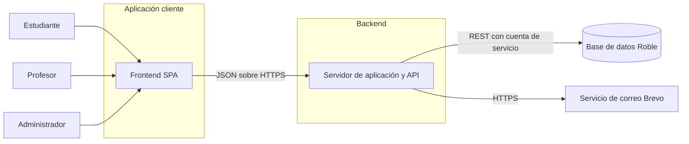
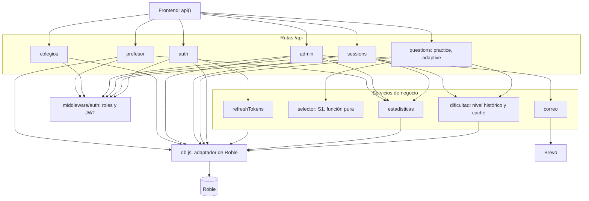
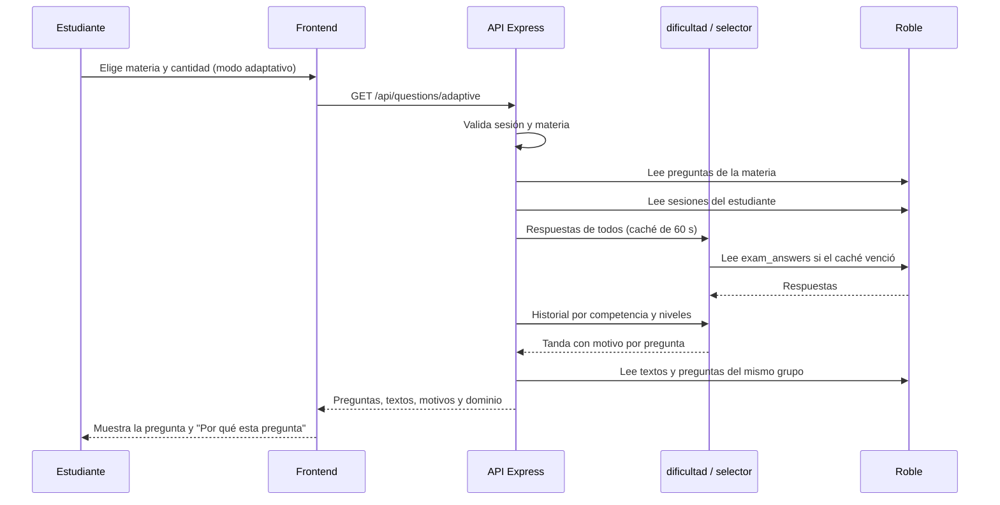
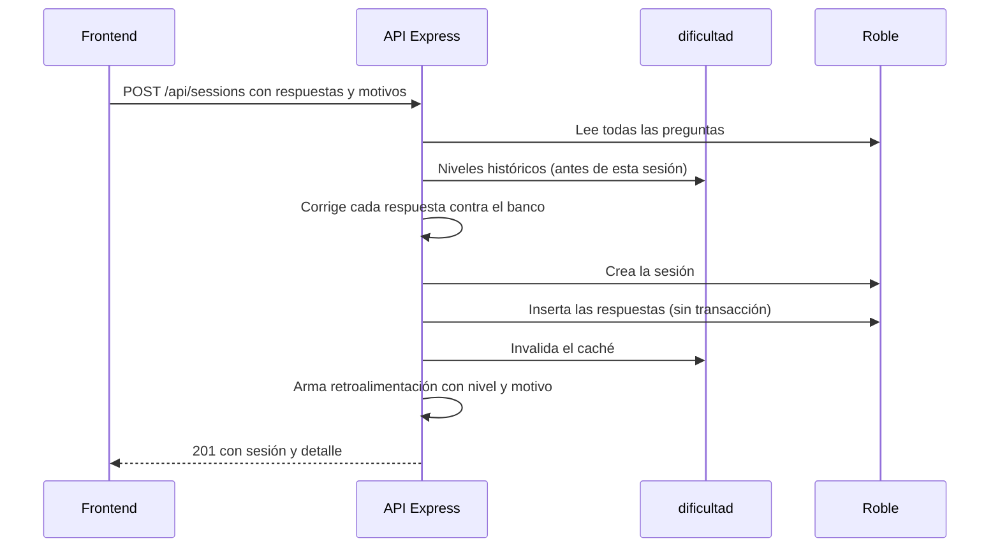
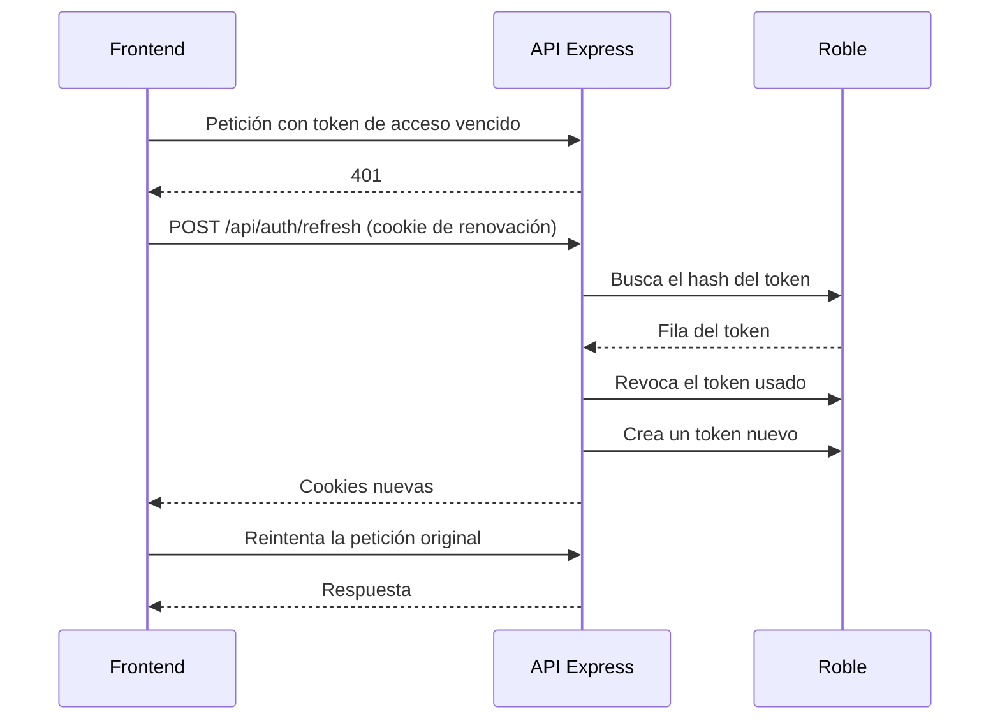
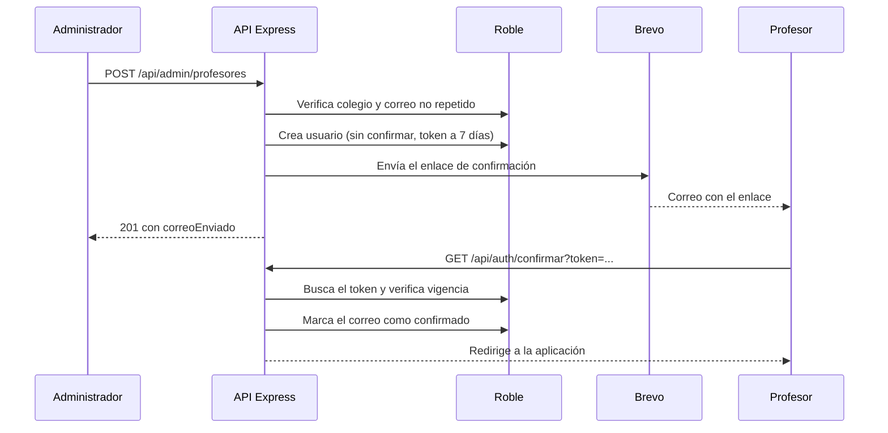

# Adapta 11 — Informe Final

**Proyecto final de Ingeniería de Sistemas · Universidad del Norte**

**Estudiantes:** José Gayón, Vanessa Orozco, Yassary Garcia
**Tutores:** Eduardo Angulo, Augusto Salazar
## Resumen / Abstract

Adapta 11 es una aplicación web para la preparación de las pruebas Saber 11 en Lectura Crítica y Matemáticas. El proyecto parte de un problema concreto: los simulacros y bancos de preguntas tradicionales presentan conjuntos similares a todos los estudiantes, de modo que quien se prepara puede invertir su tiempo en lo que ya domina y practicar poco lo que le cuesta. La solución propuesta combina un banco de preguntas clasificado por materia, competencia, eje temático y dificultad con un seguimiento del desempeño que alimenta la selección de las preguntas.

El sistema se desarrolló de forma iterativa como un prototipo cliente-servidor: un backend en Node.js y Express, un frontend de una sola página en HTML, CSS y JavaScript, y persistencia en Roble (OpenLab de Uninorte), a donde el equipo migró desde SQLite/Turso. Se implementaron tres roles (estudiante, profesor y administrador), un banco de 104 preguntas (51 de Lectura Crítica y 53 de Matemáticas) con textos compartidos e imágenes, práctica dirigida, simulacros, retroalimentación y paneles de seguimiento. En la última etapa se añadieron dos mecanismos que dan sentido adaptativo al sistema: un **nivel de dificultad histórico** de cada pregunta, calculado con el porcentaje de aciertos de los estudiantes (Fácil, Medio, Difícil o No medido), y una **práctica adaptativa** que reparte cada tanda entre refuerzo, exploración y repaso según el historial del estudiante, evita repetir preguntas y explica el motivo de cada una.

## 1. Introducción

La preparación para las pruebas Saber 11 se apoya cada vez más en plataformas digitales: simulacros oficiales del Icfes, aplicaciones comerciales y cursos virtuales. El examen evalúa, entre otras áreas, Lectura Crítica y Matemáticas, y sus resultados influyen en el acceso a la educación superior. Sin embargo, buena parte de las herramientas de práctica entregan a todos los estudiantes conjuntos de preguntas equivalentes, sin considerar qué competencias domina cada uno ni cuáles necesita reforzar.

La situación actual tiene entonces una consecuencia práctica: un estudiante con tiempo limitado puede dedicar sus sesiones a ejercicios que ya resuelve bien, mientras recibe poca práctica en las competencias donde falla. La necesidad identificada es contar con una herramienta que use la información del propio proceso de práctica (respuestas, aciertos, competencia, eje y dificultad) para que la práctica sea más pertinente. La oportunidad es aprovechar esa información sin depender de la generación automática de preguntas, trabajando sobre un banco clasificado y verificable.

Adapta 11 responde a esa necesidad con una aplicación web que ofrece dos modalidades de práctica. En la **selección dirigida**, el estudiante decide qué practicar (materia, competencia, eje y nivel de dificultad). En la **selección adaptativa**, el sistema decide a partir del historial del estudiante y le explica por qué eligió cada pregunta. Además, la plataforma incluye simulacros, retroalimentación detallada, seguimiento del progreso y vistas para profesores y administradores de colegio.

Este documento presenta el proceso completo del proyecto: el marco conceptual, el problema y su alcance, los objetivos, el estado del arte, la solución, la metodología, los requerimientos, el diseño y la arquitectura, la implementación, el despliegue, la validación y los resultados. Cuando una afirmación no pudo verificarse o medirse, se indica de forma explícita.

## 2. Marco conceptual

### 2.1 Taxonomía del Icfes y banco estructurado

El examen Saber 11 sigue un diseño centrado en evidencias: cada prueba se organiza en competencias, afirmaciones y evidencias (Icfes, 2026). En Matemáticas, las competencias evaluadas son Interpretación y representación, Formulación y ejecución, y Argumentación (Icfes, 2026). En el sistema, Lectura Crítica usa tres competencias (identifica contenidos locales, comprende el sentido global, reflexiona y evalúa el contenido) y dos ejes (literario e informativo), mientras que Matemáticas usa los ejes álgebra y cálculo, geometría y estadística.

Un **banco estructurado de preguntas** es un conjunto de ítems con metadatos que permiten recuperarlos por criterios: aquí materia, competencia, eje, dificultad, texto compartido, respuesta correcta y explicación. Esa estructura es condición necesaria para cualquier selección, dirigida o adaptativa, porque sin ella el sistema no puede distinguir qué habilidad practica cada pregunta. Su calidad limita la del selector: si una celda de la clasificación tiene una sola pregunta, ningún algoritmo puede ofrecer variedad en ella.

### 2.2 Evaluación adaptativa y práctica adaptativa

En evaluación, los tests adaptativos computarizados eligen cada ítem según la estimación actual de la habilidad del examinado, apoyados en modelos de teoría de respuesta al ítem (Lord, 1980; Embretson y Reise, 2000; van der Linden y Glas, 2000). Su objetivo es **medir con precisión**, no enseñar. Los ambientes de práctica adaptativa tienen otro objetivo: que el estudiante **mejore**, por lo que adaptan el siguiente ítem a lo que ya se sabe de él (Wauters et al., 2010; Klinkenberg et al., 2011). Adapta 11 se ubica en esta segunda categoría.

### 2.3 Dificultad de una pregunta

En la teoría clásica de los tests, la dificultad de un ítem se expresa con el **índice de dificultad**: la proporción de personas que lo responde correctamente (Crocker y Algina, 1986). Un valor alto indica una pregunta fácil y uno bajo, una difícil. Adapta 11 adopta esta definición con los datos de uso reales: la dificultad de una pregunta es el porcentaje de veces que fue contestada correctamente entre todas las veces que fue contestada, y se agrupa en niveles (véase la sección 6.3). Es una medida empírica y distinta de la etiqueta manual de dificultad que traen las preguntas del banco.

### 2.4 Modelo del estudiante y evidencia de debilidad

Un sistema adaptativo necesita estimar qué domina cada estudiante. Las propuestas clásicas son el seguimiento del conocimiento bayesiano (Corbett y Anderson, 1995) y sus variantes con redes neuronales (Piech et al., 2015). Una alternativa más simple y explicable son los sistemas de calificación tipo Elo adaptados a la educación (Elo, 1978; Pelánek, 2016), que Pelánek et al. (2017) integran en un diseño modular con tres componentes: estimación del conocimiento previo, estimación del conocimiento actual y construcción de preguntas.

Adapta 11 estima el dominio con una proporción de aciertos suavizada, interpretada como la media posterior de un modelo beta-binomial (Gelman et al., 2013). El suavizado evita conclusiones extremas con pocos datos: con 1 acierto en 1 intento, la proporción ingenua sería 100 %, mientras que la suavizada es 67 %. Una competencia se considera **débil** solo si tiene evidencia suficiente (mínimo 5 respuestas) y un dominio menor al 70 %. No se usa Elo ni aprendizaje automático: es una regla estadística simple y auditable.

### 2.5 Selección de ítems: explotación, exploración y repetición

Elegir qué preguntar equilibra explotar lo que el modelo cree (practicar donde el estudiante falla) y explorar (practicar donde no hay evidencia suficiente). Ese dilema se estudia formalmente en los problemas de bandidos multibrazo (Auer et al., 2002), y el muestreo de Thompson es una estrategia que lo resuelve (Russo et al., 2018); en recomendación para el aprendizaje, la selección de recursos a partir del perfil del usuario es una línea establecida (Manouselis et al., 2011). Adapta 11 resuelve el equilibrio con cuotas explícitas (refuerzo, exploración y repaso) en lugar de muestreo.

La repetición también importa: la práctica distribuida y la recuperación espaciada mejoran la retención (Cepeda et al., 2006; Roediger y Karpicke, 2006), pero repetir exactamente la misma pregunta puede inflar los aciertos por memoria del enunciado. El selector evita las repeticiones mientras haya preguntas sin responder y reserva una parte de cada tanda para repasar lo dominado.

### 2.6 Selección dirigida y selección adaptativa

| Aspecto | Selección dirigida | Selección adaptativa |
|---|---|---|
| Quién decide | El estudiante, con sus filtros | El sistema, a partir del historial |
| Entrada | Materia, competencia, eje, nivel y cantidad | Historial de respuestas por competencia |
| Regla | Filtra preguntas activas y las baraja al azar | Estima dominio, reparte cupos, elige nivel y evita repetidas |
| Memoria de lo respondido | Ninguna | Excluye las ya respondidas mientras haya otras |
| Justificación al estudiante | No aplica | Cada pregunta indica por qué se eligió |
| Estado | Implementada | Implementada (estrategia S1) |

## 3. Planteamiento del problema

### 3.1 Descripción del problema

El problema no es la ausencia de preguntas sino la dificultad de decidir cuáles son pertinentes para cada estudiante en un momento dado. Un estudiante de grado once con tiempo limitado puede recibir ejercicios de contenidos que ya domina, mientras las competencias donde falla reciben poco refuerzo. Esto afecta principalmente a quienes se preparan sin acompañamiento personalizado, y su consecuencia es un uso poco eficiente del tiempo de estudio.

Las causas son estructurales. Los simulacros tradicionales se construyen como pruebas fijas, de modo que todos los estudiantes ven preguntas equivalentes. Los bancos de preguntas, por su parte, suelen carecer de una medida confiable de dificultad basada en datos de uso, y los estudiantes rara vez reciben una explicación de por qué se les presenta un ejercicio determinado.

Adicionalmente, los docentes y colegios cuentan con poca visibilidad sobre el desempeño por competencia de sus estudiantes en este tipo de plataformas. El proyecto aborda estos tres frentes: la selección de las preguntas, la medición de su dificultad y la visibilidad del desempeño.

### 3.2 Restricciones y supuestos de diseño

**Alcance de contenido.** El sistema trabaja con Lectura Crítica y Matemáticas; el esquema restringe el campo `materia` a estas dos opciones. El banco semilla excluye las preguntas de los cuadernillos fuente que dependen de imágenes complejas, lo que explica en parte la baja presencia de geometría (9 de 104 preguntas).

**Tamaño y composición del banco.** Con 104 preguntas repartidas en seis competencias y cinco ejes, varias celdas son muy pequeñas (Interpretación y representación × Geometría tiene una sola pregunta). La dificultad etiquetada está confundida con la competencia (Reflexiona y evalúa tiene 12 de sus 14 preguntas difíciles; Identifica contenidos locales no tiene ninguna) y la letra de la respuesta correcta está sesgada (B en 40 preguntas y C en 36). El selector se diseñó tolerando estas limitaciones.

**Persistencia.** Roble solo permite leer con filtros de igualdad, sin `JOIN`, `IN`, agregaciones ni orden aleatorio, por lo que esas operaciones se realizan en JavaScript sobre los datos ya traídos. Esto condiciona el rendimiento y el diseño de los módulos de estadísticas, dificultad y selección.

**Tiempo, recursos y datos.** El proyecto se desarrolló dentro de un semestre académico, con hospedaje gratuito y sin presupuesto. No se dispone de un volumen de respuestas que permita calibrar el banco con teoría de respuesta al ítem. Los parámetros del selector son propuestas fundamentadas, no valores calibrados con datos reales.

**Supuestos.** Se asume que el porcentaje de aciertos de una pregunta es una aproximación razonable de su dificultad cuando existen suficientes respuestas, y que el desempeño por competencia es un indicador útil para decidir qué reforzar. Los secretos (clave JWT, credenciales de Roble, clave de Brevo y contraseña del administrador) se mantienen en variables de entorno.

### 3.3 Alcance

**Incluye.** Una aplicación web para tres roles: estudiantes (registro, práctica dirigida y adaptativa, simulacros, retroalimentación y progreso), profesores (consulta de los estudiantes de su colegio, creados por el administrador y confirmados por correo) y administradores (gestión del banco, textos compartidos, colegios y profesores, y vistas agregadas). Incluye un banco de 104 preguntas, el nivel de dificultad histórico de cada pregunta, la práctica adaptativa con motivo visible, y el despliegue en Render con Roble como base de datos.

**No incluye.** La generación automática de preguntas con modelos de lenguaje y su validación; las otras tres áreas del Saber 11; un puntaje equivalente al oficial del Icfes; la calibración de ítems con teoría de respuesta al ítem; y una versión móvil nativa. Tampoco incluye la comparación con estudiantes reales de la efectividad pedagógica de la adaptación.

## 4. Objetivos

**Objetivo general.** Diseñar e implementar un prototipo de sistema de seguimiento adaptativo para la preparación del Saber 11, que seleccione dinámicamente preguntas de un banco estructurado para Matemáticas y Lectura Crítica, de acuerdo con el área de interés y el desempeño de cada estudiante.

**Objetivos específicos y estado de cumplimiento.**

| # | Objetivo específico | Estado | Evidencia |
|---|---|---|---|
| 1 | Construir y organizar un banco de preguntas de Matemáticas y Lectura Crítica clasificado por competencia, eje y dificultad | Cumplido | 104 preguntas validadas (`scripts/validar-banco.js`); administración del banco desde la aplicación; nivel de dificultad histórico por pregunta |
| 2 | Diseñar un mecanismo de selección que presente ejercicios según el área o competencia que el estudiante desee trabajar | Cumplido | Práctica dirigida por materia, competencia, eje y nivel (`GET /api/questions/practice`) |
| 3 | Diseñar un mecanismo de selección adaptativa que use el historial de respuestas para identificar fortalezas y debilidades | Cumplido en implementación; efectividad no demostrada con estudiantes reales | `src/lib/selector.js`, `GET /api/questions/adaptive`; simulación con estudiantes sintéticos |
| 4 | Implementar un sistema de seguimiento del desempeño y su evolución | Cumplido | Tablas `exam_sessions` y `exam_answers`; `estadisticas.js`; pantalla de progreso |
| 5 | Diseñar un sistema de retroalimentación que oriente las sesiones futuras | Cumplido | Explicación por pregunta, competencias a reforzar, nivel de la pregunta y motivo de selección |

El objetivo general se cumple en lo que respecta a construcción. Sin embargo, el enunciado original menciona "técnicas de inteligencia artificial": el selector implementado usa estadística simple y reglas explícitas, no aprendizaje automático. Esa decisión se tomó para que cada selección fuera explicable y verificable.

## 5. Estado del arte / soluciones relacionadas

Se compararon soluciones de preparación para Saber 11 con criterios que pueden contrastarse con documentación pública: (1) alineación con Saber 11; (2) preguntas clasificadas por competencia o eje; (3) seguimiento del desempeño por competencia; (4) selección adaptativa documentada, es decir, con la regla o el modelo descritos públicamente; (5) explicación al estudiante de por qué se le asigna una pregunta; y (6) vista para docentes o colegios. La tabla distingue **Documentado** (la fuente lo afirma), **Declarado** (afirmación comercial sin detalle técnico) y **No documentado** (la fuente consultada no lo menciona). *No documentado no significa que no exista*: las fuentes son fichas de producto y prensa, y no se probó ninguna plataforma.

### 5.2 Soluciones de preparación para Saber 11

| Criterio | Preicfes (Icfes) | Oesaber | Sabero | Supertest |
|---|---|---|---|---|
| 1. Alineación con Saber 11 | Documentado: plataforma del Icfes con las cinco áreas | Declarado: simula el formato de Saber 11 | Declarado: preguntas "tipo ICFES" y simulacros | Declarado: simulacros Saber 11 y Saber Pro |
| 2. Clasificación por competencia/eje | No documentado | No documentado | No documentado | Declarado: materia, componente y competencia |
| 3. Seguimiento por competencia | No documentado | Declarado: diagnóstico y análisis de fortalezas y debilidades | Declarado: análisis por materia | Declarado: análisis por materia y competencia |
| 4. Selección adaptativa documentada | Declarado: prueba adaptativa; algoritmo no publicado | Declarado: adapta contenidos y ejercicios; sin detalle | Declarado: coach de IA y puntaje por TRI; sin detalle | Declarado: misiones diarias que se ajustan a los resultados; sin detalle |
| 5. Explica por qué asigna cada pregunta | No documentado | No documentado | Parcial: tutor que explica cada pregunta, no por qué se asignó | No documentado |
| 6. Vista para docentes o colegios | No documentado | No documentado | No documentado | No documentado |

Fuentes: La República (2019) y El Universal (2020) para el Icfes; Enter.co (s. f.) para Oesaber; Sabero (s. f.); Supertest Tech Inc. (2026). Las fichas de Sabero y Supertest son autodescripciones de sus proveedores, y las notas de prensa sobre el Icfes datan de 2019 y 2020, por lo que no se verificó su disponibilidad actual.

### 5.3 Aprendizaje adaptativo y recomendación de ítems

| Enfoque | Qué decide | Fortaleza | Limitación para Adapta 11 | Fuente |
|---|---|---|---|---|
| Test adaptativo computarizado (TRI) | El ítem más informativo según la habilidad estimada | Medición precisa con pocos ítems | Exige ítems calibrados con muchas respuestas | Lord (1980); van der Linden y Glas (2000) |
| Seguimiento del conocimiento | Probabilidad de dominio de cada habilidad | Modela el aprendizaje en el tiempo | Requiere mapeo ítem–habilidad y datos para ajustar parámetros | Corbett y Anderson (1995); Piech et al. (2015) |
| Práctica adaptativa con Elo | Ítems de dificultad apropiada según la habilidad estimada | Simple, robusta y explicable | Necesita volumen de respuestas para estabilizarse | Klinkenberg et al. (2011); Pelánek (2016); Pelánek et al. (2017) |
| Bandidos / muestreo de Thompson | Qué practicar, equilibrando explotación y exploración | Maneja la incertidumbre con pocos datos | La recompensa debe definirse con cuidado | Auer et al. (2002); Russo et al. (2018) |
| Recomendación educativa | Recursos acordes al perfil | Marco general de personalización | Requiere adaptarse a ítems de opción múltiple | Manouselis et al. (2011) |

### 5.4 Brecha y posicionamiento

Ninguna de las cuatro soluciones consultadas documenta públicamente la regla con que selecciona preguntas ni explica al estudiante por qué le asigna cada una, y ninguna menciona una vista para docentes o colegios. La brecha que Adapta 11 propone cubrir es la de una **selección de preguntas transparente, reproducible y explicable, con seguimiento por competencia y vistas para colegios**. Esa propuesta se materializó en el prototipo: la regla de selección está publicada en el repositorio, es determinista, y cada pregunta muestra su motivo.

Frente a las alternativas comerciales existen desventajas verificables: un banco de 104 preguntas frente a las más de 10 000 que declara Sabero, sin calibración TRI y sin puntaje oficial. La contribución del proyecto es de método y transparencia, no de volumen de contenido ni de eficacia demostrada.

## 6. Solución propuesta

### 6.1 Enfoque, usuarios y propuesta de valor

Adapta 11 es una aplicación web con interfaz para tres tipos de usuario. El estudiante practica, presenta simulacros y consulta su progreso. El profesor y el administrador gestionan contenido y observan información agregada. La propuesta de valor es ofrecer práctica estructurada por competencia con seguimiento y retroalimentación, y orientar esa práctica con el historial del estudiante justificando cada decisión.

La solución se guía por tres principios. Primero, **explicabilidad**: cada pregunta adaptativa informa por qué se eligió. Segundo, **evidencia antes que etiqueta**: la dificultad se mide con respuestas reales en lugar de depender solo de la clasificación manual. Tercero, **simplicidad auditable**: se prefirió una regla estadística clara frente a un modelo opaco, dado el tamaño del banco y la cantidad de datos disponibles.

### 6.2 Respuesta a la necesidad dentro del alcance

El problema descrito en la sección 3 se atiende en tres frentes. La **selección de preguntas** se cubre con dos modos: dirigida (el estudiante decide) y adaptativa (el sistema decide). La **medición de la dificultad** se cubre con el nivel histórico por pregunta. La **visibilidad del desempeño** se cubre con el seguimiento por competencia, la retroalimentación por sesión y las vistas de profesor y administrador.

Se descartó la generación automática de preguntas por dos razones: exige una validación pedagógica que excede el alcance del semestre y no es necesaria para demostrar la selección adaptativa. Se descartó también calibrar el banco con teoría de respuesta al ítem por falta de volumen de respuestas, y se optó por el índice de dificultad clásico, que es interpretable con pocos datos.

### 6.3 Qué se construyó

**Banco estructurado.** La semilla contiene 104 preguntas:

| Materia | Competencia | Fácil | Media | Difícil | Total |
|---|---|---|---|---|---|
| Lectura Crítica | Identifica contenidos locales | 8 | 2 | 0 | 10 |
| Lectura Crítica | Comprende el sentido global | 6 | 14 | 7 | 27 |
| Lectura Crítica | Reflexiona y evalúa el contenido | 0 | 2 | 12 | 14 |
| Matemáticas | Interpretación y representación | 6 | 3 | 1 | 10 |
| Matemáticas | Formulación y ejecución | 6 | 11 | 8 | 25 |
| Matemáticas | Argumentación | 3 | 10 | 5 | 18 |
| | **Total** | **29** | **42** | **33** | **104** |

**Nivel de dificultad histórico.** La dificultad de cada pregunta se calcula como `aciertos / veces contestada`, con las respuestas de práctica y simulacro de todos los estudiantes, sin contar las preguntas dejadas en blanco. Los rangos son:

| Nivel | Regla | Justificación |
|---|---|---|
| Fácil | 70 % o más de aciertos | Coincide con el umbral de "a reforzar" de la retroalimentación |
| Medio | De 40 % a menos de 70 % | Zona intermedia |
| Difícil | Menos de 40 % | Con cuatro opciones, adivinar al azar da cerca de 25 % |
| No medido | Menos de 5 respuestas | Con muy pocos intentos el porcentaje no es informativo |

Los umbrales y el mínimo de respuestas son configurables por variables de entorno (`DIFICULTAD_UMBRAL_FACIL`, `DIFICULTAD_UMBRAL_DIFICIL`, `DIFICULTAD_MIN_RESPUESTAS`). El nivel aparece en el banco del administrador y en la revisión de resultados de práctica y simulacro. Es distinto de la etiqueta manual `dificultad` del banco, que se conserva porque la usan el simulacro y el nivel estimado.

**Práctica dirigida con nivel.** Al iniciar una práctica, el estudiante elige materia, competencia, eje y nivel de dificultad (Fácil, Medio, Difícil o Aleatorio). Si no hay suficientes preguntas del nivel pedido, se completan con preguntas "No medido" y se avisa; así esas preguntas acumulan respuestas y terminan teniendo nivel.

**Práctica adaptativa (estrategia S1).** Es una regla determinista que usa el historial del estudiante en la materia elegida:

1. **Unidad de práctica:** la competencia.
2. **Dominio:** `p = (aciertos + 1) / (respuestas + 2)` por competencia. Con menos de 5 respuestas la competencia es *sin evidencia*; con 5 o más es *débil* si `p < 70 %` y *dominada* si no.
3. **Reparto de la tanda:** 60 % refuerzo (competencias débiles, la más floja primero), 25 % exploración (competencias sin evidencia) y 15 % repaso (competencias dominadas). Si un grupo está vacío, su cupo pasa al siguiente que tenga competencias; un estudiante nuevo recibe toda la tanda como exploración repartida.
4. **Nivel de la pregunta:** según el dominio de la competencia: `p < 40 %` pide Fácil, `p < 70 %` Medio y `p ≥ 70 %` Difícil (exploración: Medio). Si no hay preguntas de ese nivel, prefiere las "No medido" y luego las de nivel cercano.
5. **Repetición:** primero las preguntas nunca respondidas; al agotarse, vuelven primero las falladas y las respondidas hace más tiempo.
6. **Motivo:** cada pregunta devuelve un texto como *"Refuerzo: Argumentación (4 de 9 aciertos, 44 %). Nivel de la pregunta: Medio."*, que se muestra durante la práctica y en la revisión.

La regla es determinista: con el mismo historial y el mismo banco devuelve la misma selección. Los parámetros (60/25/15, umbrales y mínimo de evidencia) son una propuesta fundamentada, no valores calibrados con datos reales.

## 7. Metodología de desarrollo

### 7.1 Enfoque metodológico

El proyecto siguió un **prototipado iterativo e incremental**. Se eligió porque el problema tenía incertidumbre técnica (qué significa adaptar, qué datos hacen falta) y porque permitía entregar un sistema recorrible de extremo a extremo desde etapas tempranas, e incorporar mejoras a partir de los hallazgos de cada revisión. Cada iteración produjo un prototipo funcional y un informe que documentaba su estado.

El código se organizó para sostener ese ritmo: rutas independientes por dominio (autenticación, preguntas, sesiones, administración, colegios, profesores), middleware de autorización, bibliotecas auxiliares y una capa de acceso a datos en `src/db.js`. Esa separación permitió, por ejemplo, reemplazar la base de datos y agregar el selector adaptativo sin reescribir los módulos no relacionados.

### 7.2 Iteraciones o fases

**Fase 1 — Banco y clasificación.** Banco clasificado por materia, dificultad, competencia y eje; textos compartidos e imágenes; administración (crear, editar, desactivar); semilla idempotente.

**Fase 2 — Práctica dirigida y simulacro.** Práctica filtrada por materia, competencia y eje; simulacro con mezcla de dificultades; registro de sesiones y corrección en servidor.

**Fase 3 — Seguimiento, roles y seguridad.** Retroalimentación por sesión, estadísticas y evolución; roles por colegio; confirmación de correo de profesores; tokens de renovación revocables; migración de la base de datos a Roble; imágenes en preguntas, opciones y textos; eliminación de preguntas duplicadas.

**Fase 4 — Adaptabilidad.** Nivel de dificultad histórico; selector de nivel en la práctica; práctica adaptativa con motivo visible; registro opcional de estrategia y motivo; pruebas automatizadas con base de datos simulada; simulación con estudiantes sintéticos.

### 7.3 Mecanismos de validación

Se emplearon cinco mecanismos: revisión de sintaxis con `node --check`; pruebas automatizadas de lógica y rutas con una base de datos simulada en memoria (`prueba-dificultad.js`, `prueba-selector.js`); validación estructural del banco (`scripts/validar-banco.js`); simulación reproducible con estudiantes sintéticos (`scripts/simular-estrategias.js`); y la validación inicial con un grupo reducido de estudiantes en el entorno desplegado. Las limitaciones de cada uno se discuten en las secciones 13 y 14.

### 7.4 Artefactos generados

Además del código, el proceso generó tres informes (planteamiento, avance y final), la guía de despliegue, el script SQL de cambios de esquema para Roble (`scripts/cambios-roble.sql`), los scripts de migración desde Turso y de eliminación de duplicados, y los scripts de verificación y simulación mencionados. El detalle del plan original está en el [Primer Informe](./PrimerInforme.md#7-metodología-de-desarrollo-y-plan-de-trabajo).

## 8. Requerimientos

### 8.1 Funcionales

| ID | Requerimiento | Estado |
|---|---|---|
| RF-01 | Registro e inicio de sesión de estudiantes, con colegio obligatorio | Implementado |
| RF-02 | Cuentas de profesor creadas por el administrador, con confirmación por correo | Implementado (el envío depende de Brevo configurado) |
| RF-03 | Control de acceso por rol (estudiante, profesor, administrador) | Implementado |
| RF-04 | Administración del banco: crear, editar y desactivar preguntas, con imágenes en pregunta, opciones y texto | Implementado |
| RF-05 | Textos compartidos con grupos de preguntas que se muestran juntas | Implementado |
| RF-06 | Práctica dirigida por materia, competencia y eje | Implementado |
| RF-07 | Elección del nivel de dificultad al iniciar una práctica (Fácil, Medio, Difícil, Aleatorio) | Implementado |
| RF-08 | Simulacro por materia(s) con mezcla de dificultades y nivel estimado | Implementado (nivel estimado heurístico) |
| RF-09 | Registro de sesiones y respuestas con corrección en el servidor | Implementado |
| RF-10 | Retroalimentación por sesión: explicación, tiempo, competencias a reforzar, nivel y motivo | Implementado |
| RF-11 | Seguimiento del estudiante: resumen, desgloses por competencia y evolución | Implementado |
| RF-12 | Vistas agregadas para profesor (su colegio) y administrador, incluida la comparativa entre colegios | Implementado |
| RF-13 | Nivel de dificultad histórico por pregunta, visible en el banco del administrador y en la revisión de resultados | Implementado |
| RF-14 | Práctica adaptativa a partir del historial del estudiante | Implementado (estrategia S1) |
| RF-15 | Mostrar al estudiante por qué se eligió cada pregunta | Implementado |
| RF-16 | Evitar repetir preguntas ya respondidas mientras haya alternativas | Implementado en la práctica adaptativa; no aplica a la dirigida ni al simulacro |
| RF-17 | Registrar la estrategia y el motivo de cada sesión para evaluarla | Parcial: implementado pero desactivado por defecto (requiere dos `ALTER TABLE` en Roble y `GUARDAR_ESTRATEGIA=1`) |

### 8.2 No funcionales

**Seguridad.** Las contraseñas se almacenan con `bcryptjs` (costo 10). El token de acceso dura 15 minutos y el de renovación 30 días; este último se guarda como hash SHA-256, rota en cada uso y se revoca al cerrar sesión, y su cookie solo viaja a `/api/auth`. Las cookies son `httpOnly`, `sameSite=lax` y `secure` en producción. Las rutas administrativas y de profesor están protegidas por middleware, y el servidor recalcula la corrección de cada respuesta en lugar de confiar en el navegador. **Pendientes:** no hay limitación de intentos de inicio de sesión ni cabeceras de seguridad (`helmet`), el código usa valores por defecto para `JWT_SECRET` y la contraseña del administrador si faltan variables de entorno, y la contraseña mínima es de seis caracteres.

**Usabilidad.** Interfaz de una sola página con vistas por rol, utilizable desde el navegador de un celular (véanse las capturas en la sección 11.2). El motivo de cada pregunta adaptativa y el nivel de dificultad se muestran en lenguaje no técnico. No se ha medido formalmente (sección 13.3).

**Rendimiento y escalabilidad.** No hay mediciones. Se propone como objetivo, a validar, una latencia p95 menor a 2 s al cargar una tanda con 10 usuarios concurrentes y una tasa de errores menor al 1 %. La arquitectura actual lee tablas completas de Roble en varias operaciones (véase la sección 10.1.2.3), por lo que se espera que degrade con el volumen de datos.

**Mantenibilidad.** El backend se divide en rutas, middleware, bibliotecas y capa de datos. El frontend concentra 2 650 líneas en `public/js/app.js`, lo que dificulta su prueba y evolución. Las pruebas automatizadas cubren la lógica de dificultad y selección, pero no el resto del sistema (sección 13.1).

**Disponibilidad y portabilidad.** Depende de Render y de Roble. `src/db.js` expone una interfaz CRUD (`leer`, `porId`, `dondeEn`, `crear`, `crearVarias`, `actualizar`, `borrar`) que permite sustituir el almacén reimplementando esas funciones; los identificadores pasaron de enteros a UUID de texto, y esa diferencia debe respetarse.

## 9. Evaluación de alternativas

El análisis completo está en el [Segundo Informe, sección 9](./SegundoInforme.md#9-evaluación-de-alternativas). Aquí se resume y se actualiza con el estado final.

**Estrategia de selección.** Se consideraron tres: S0 (aleatoria dentro de los filtros, sin memoria), S1 (regla determinista por cuotas) y S2 (muestreo de Thompson). Se implementó **S1** por ser explicable y reproducible: permite mostrar al estudiante un motivo comprensible y comparar resultados con la misma semilla. S2 no se implementó; su exploración surge de la incertidumbre y es más difícil de justificar en una pregunta individual. La comparación S0 frente a S1 se realizó con estudiantes sintéticos (sección 14.1); la comparación con S2 queda como trabajo futuro.

**Persistencia.** Se compararon SQLite local, Turso/libSQL y Roble. Se adoptó **Roble** por ser la base compartida del equipo y conservar los datos entre despliegues, aceptando su costo: no ofrece agregaciones ni ordenamiento aleatorio, así que el sistema agrega y baraja en JavaScript. Las mediciones de latencia, errores y concurrencia que el Segundo Informe definió **no se ejecutaron**; la comparación de persistencia sigue siendo cualitativa y se basa en lo verificable en el código.

| Criterio | SQLite local | Turso / libSQL | Roble (adoptado) |
|---|---|---|---|
| Consultas | SQL completo | SQL completo | Solo igualdad exacta |
| Agregación y orden aleatorio | En la base de datos | En la base de datos | En Node |
| Datos compartidos por el equipo | No (archivo local) | Sí | Sí |
| Latencia, errores y concurrencia | No medido | No medido | No medido |

La decisión se mantiene provisionalmente. Si el volumen de datos crece, la alternativa más directa es desnormalizar `user_id` en `exam_answers` o volver a una base con consultas SQL.

## 10. Diseño y arquitectura

Las figuras de esta sección están numeradas y cada una se explica en el texto. Los diagramas se escriben en Mermaid y se renderizan en GitHub.

### 10.1 Arquitectura

#### 10.1.1 Descripción general de la arquitectura

La arquitectura es **cliente-servidor en tres capas**. El navegador ejecuta una aplicación de una sola página; un único servicio Node.js con Express sirve los archivos estáticos, expone la API `/api/*` y aplica las reglas de acceso; y los datos residen en Roble, al que el servidor accede por HTTP con una cuenta de servicio. No se usa un backend como servicio (BaaS) consumido directamente desde el navegador: el cliente nunca habla con Roble.

Esta organización responde a la alternativa seleccionada (sección 9): un servicio único simplifica el despliegue y la capa `db.js` aísla la persistencia. A cambio, la lógica de agregación, dificultad y selección vive en el servidor y se ejecuta en JavaScript sobre los datos traídos de Roble, lo que condiciona el rendimiento. La comunicación entre cliente y servidor es JSON sobre HTTPS con cookies `httpOnly`. El correo de confirmación de profesores se envía por la API HTTP de Brevo, no por SMTP, porque el plan gratuito de Render bloquea esos puertos.

#### 10.1.2 Componentes del sistema e interacción

##### 10.1.2.1 Descripción de componentes

El **frontend** (`public/`) presenta formularios, práctica, simulacro, resultados, progreso y administración, y mantiene el estado de la aplicación. Su función `api()` centraliza las solicitudes, el manejo de errores y la renovación automática del token de acceso. Responde a RF-01 a RF-15.

El **backend** (`src/server.js` y `src/routes/`) procesa autenticación, preguntas, sesiones, administración, colegios y profesores, y expone 35 endpoints en seis grupos de rutas. Aplica el control de acceso por rol y la corrección de las respuestas. Incluye además la lógica de negocio del proyecto: el cálculo del nivel de dificultad (`lib/dificultad.js`), el selector adaptativo (`lib/selector.js`) y las estadísticas (`lib/estadisticas.js`). Responde a RF-03 y RF-06 a RF-17.

La **base de datos** es Roble, que almacena siete tablas: `users`, `colegios`, `textos`, `questions`, `exam_sessions`, `exam_answers` y `refresh_tokens`. Se accede mediante la capa `src/db.js`, que inicia sesión con una cuenta de servicio y expone operaciones CRUD. Los **servicios externos** son Brevo (correo de confirmación de profesores) y Render (hospedaje del servidor, descrito en la sección 12).

*Figura 1. Diagrama de arquitectura del sistema.* Muestra la estructura lógica de alto nivel: los actores, el frontend, el backend, la base de datos y los servicios externos. No detalla los módulos internos ni la infraestructura.

##### 10.1.2.2 Interacción entre módulos

El frontend se comunica con el backend únicamente mediante la función `api()`. Cada ruta valida el rol con el middleware, ejecuta su lógica y consulta datos mediante `db.js`. Las rutas de práctica y sesiones colaboran con dos módulos de negocio: `dificultad.js`, que calcula el nivel histórico de cada pregunta, y `selector.js`, una función pura que decide la tanda adaptativa a partir del historial que le entrega la ruta. Las estadísticas se centralizan en `estadisticas.js`, reutilizado por los tres roles, y la lectura de `exam_answers` se comparte mediante un caché en memoria de 60 segundos que se invalida al guardar una sesión.

El acoplamiento es moderado. El frontend depende de la forma de los endpoints y los nombres de campos; las rutas dependen de la interfaz de `db.js` y de la semántica de Roble (identificadores UUID, filtros por igualdad). El selector es el módulo menos acoplado: no accede a la base de datos y recibe todo por parámetros, lo que permitió probarlo de forma aislada y simularlo.

*Figura 2. Diagrama de interacción entre módulos.* Abre el backend de la Figura 1 y muestra cómo colaboran los grupos de rutas, el middleware, las bibliotecas de negocio y la capa de acceso a datos (adaptador de Roble).

##### 10.1.2.3 Comportamiento

Se describen cuatro procesos clave, cada uno correspondiente a un caso de uso real.

**Proceso 1: práctica adaptativa (Figura 3).** El estudiante elige la materia y la cantidad de preguntas. El servidor lee las preguntas de la materia, las sesiones del estudiante y las respuestas (con caché), calcula el historial por competencia y le entrega al selector los datos; el selector devuelve la tanda con su motivo, y el servidor completa los grupos de texto compartido. El resultado es una lista de preguntas con motivo y un resumen del dominio por competencia. Los posibles errores son materia inválida (400) o una falla de lectura de Roble (500); en esta versión **no existe un respaldo automático** a la selección dirigida, y el estudiante ve un mensaje de error. Los puntos de espera son las tres lecturas a Roble.

*Figura 3. Secuencia de la práctica adaptativa.*

**Proceso 2: finalizar una sesión y recibir la retroalimentación (Figura 4).** El frontend envía las respuestas. El servidor lee el banco de preguntas, corrige cada respuesta contra él (no confía en el navegador), calcula el nivel histórico de cada pregunta *antes* de sumar esta sesión, guarda la sesión y sus respuestas, invalida el caché y devuelve la retroalimentación. El flujo es corto, pero tiene dos puntos delicados: la corrección lee **todo** el banco, incluidas las imágenes en base64, y la inserción de la sesión y la de sus respuestas son llamadas separadas **sin transacción**: si algunas respuestas se omiten, la sesión queda guardada con su nota pero sin parte del detalle, y solo hay constancia en el registro del servidor.

*Figura 4. Secuencia de finalización de sesión y retroalimentación.*

**Proceso 3: renovación de la sesión (Figura 5).** Cuando el token de acceso (15 minutos) vence, el frontend recibe un 401, llama a `/api/auth/refresh` con la cookie de renovación, el servidor valida el hash del token, lo revoca, crea uno nuevo y entrega cookies nuevas; el frontend reintenta la petición original. Es transparente para el usuario. La rotación no es atómica (revoca y luego crea): si falla entre ambos pasos, el usuario debe iniciar sesión de nuevo.

*Figura 5. Secuencia de renovación de sesión.*

**Proceso 4: alta y confirmación de un profesor (Figura 6).** El administrador crea la cuenta; el servidor valida los datos, guarda al profesor sin confirmar con un token que vence en 7 días y envía el enlace por Brevo. Si el correo falla, la cuenta queda creada y la respuesta informa `correoEnviado: false` para que el administrador reenvíe la confirmación. El profesor no puede iniciar sesión hasta abrir el enlace, momento en que el servidor verifica el token y su vigencia y marca el correo como confirmado.

*Figura 6. Secuencia de alta y confirmación de un profesor.*

**Eficiencia, cuellos de botella y acoplamiento.** Los flujos tienen pocos pasos y ninguno es innecesario. Los cuellos de botella son de volumen de datos, no de pasos: la corrección lee el banco completo, las estadísticas leen las tablas de sesiones y respuestas completas, la selección adaptativa lee `exam_answers` completo (mitigado por el caché de 60 s), y `completarGrupos()` hace lecturas secuenciales por cada texto compartido. Estos son hallazgos de revisión de código; **no se cuantificaron** con mediciones de latencia. El desacoplamiento es aceptable para el tamaño del prototipo, con el frontend monolítico como el punto menos modular.

## 11. Implementación

### 11.1 Stack tecnológico

| Capa | Tecnología | Justificación |
|---|---|---|
| Servidor | Node.js ≥ 18, Express 4 | Un solo servicio sirve la API y el frontend |
| Autenticación | `jsonwebtoken`, `bcryptjs`, `cookie-parser` | Tokens de corta duración en cookies `httpOnly`; contraseñas con hash |
| Datos | Roble OpenLab (API REST), `fetch` nativo | Base compartida por el equipo; sin controlador adicional |
| Correo | API HTTP de Brevo | Render bloquea SMTP en el plan gratuito |
| Frontend | HTML, CSS y JavaScript sin framework | Pocas dependencias y despliegue simple |
| Despliegue | Render (`render.yaml`) | Hospedaje gratuito del servidor |
| Pruebas y verificación | Scripts de Node.js propios | Sin framework de pruebas; usan una base de datos simulada |
| Herramientas | `dotenv`; `@libsql/client` (solo para la migración desde Turso) | Configuración por variables de entorno |

### 11.2 Componentes

| Componente | Estado | Funcionalidad | Decisiones y diferencias con el diseño |
|---|---|---|---|
| Autenticación y roles | Implementado | Registro, sesión con token de acceso y renovación, roles, confirmación de profesores | Se añadió la renovación revocable, no prevista al inicio |
| Banco y textos compartidos | Implementado | CRUD, imágenes en pregunta, opciones y texto, baja lógica, semilla idempotente | Se añadió la eliminación de duplicados |
| Práctica dirigida y simulacro | Implementado | Filtros por materia, competencia, eje y nivel; simulacro con mezcla de dificultades | El nivel usa el histórico y no la etiqueta manual |
| Nivel de dificultad histórico | Implementado | `aciertos / veces contestada`, cuatro niveles, caché de 60 s | Se calcula al vuelo; no se guardan contadores para evitar cambios de esquema |
| Práctica adaptativa (S1) | Implementado | Reparto 60/25/15, nivel según dominio, sin repetir, motivo por pregunta | Se descartó S2 (Thompson) y el respaldo automático a la selección dirigida |
| Seguimiento y retroalimentación | Implementado | Resumen, desgloses, evolución, explicación, competencias a reforzar | — |
| Paneles de profesor y administrador | Implementado | Estudiantes por colegio, comparativa entre colegios, banco con nivel | El profesor no gestiona el banco |
| Registro de estrategia y motivo | Parcial | Columnas `estrategia` y `motivo_seleccion` | Desactivado por defecto: requiere `ALTER TABLE` previo en Roble |

### 11.3 Integraciones
### 11.3 Integraciones

Adapta 11 se conecta con tres servicios externos. El navegador nunca habla directamente con ninguno: todas las conexiones salen del servidor Express.

| Servicio | Para qué se usa | Cómo se integra | Estado |
| --- | --- | --- | --- |
| **Roble** (OpenLab de Uninorte) | Persistencia de las siete tablas: `users`, `colegios`, `textos`, `questions`, `exam_sessions`, `exam_answers` y `refresh_tokens` | API REST consumida con `fetch` nativo desde la capa `src/db.js`, que inicia sesión con una cuenta de servicio y expone operaciones CRUD | Implementado y en uso en producción |
| **Brevo** | Envío del correo de confirmación de los profesores (RF-02) | API HTTP con `BREVO_API_KEY`; no se usa SMTP porque Render lo bloquea en el plan gratuito | Implementado; el envío depende de tener Brevo configurado |
| **Render** | Hospedaje del servidor Node.js (véase la sección 12) | Despliegue desde GitHub con `render.yaml` | Implementado y en uso en producción |

**Roble.** Es la integración más importante y la más condicionante. Solo permite leer con filtros de igualdad, sin `JOIN`, `IN`, agregaciones ni orden aleatorio, por lo que esas operaciones se hacen en JavaScript sobre los datos ya traídos (véase la sección 3.2). Sus identificadores son UUID de texto, no enteros. La capa `db.js` aísla esta dependencia: si se cambiara el almacén, bastaría con reimplementar sus funciones. Para reducir lecturas repetidas se usa un caché en memoria de 60 segundos sobre `exam_answers`.

**Brevo.** Al crear una cuenta de profesor, el servidor genera un token con vigencia de 7 días y envía el enlace de confirmación. Si el envío falla, la cuenta queda creada y la respuesta devuelve `correoEnviado: false`, para que el administrador reenvíe la confirmación. El profesor no puede iniciar sesión hasta abrir el enlace.

**Turso (descartada).** El proyecto usó antes SQLite/Turso. Hoy `@libsql/client` solo se conserva como dependencia del script de migración de datos hacia Roble.

## 12. Despliegue y operación

## 13. Validación

### 13.1 Pruebas por componentes

### 13.2 Pruebas de integración

### 13.3 Pruebas de usabilidad

## 14. Resultados, discusión y conclusiones

## 15. Trabajo futuro

**Evaluación con estudiantes reales.** Activar el registro de estrategia y motivo (`GUARDAR_ESTRATEGIA=1`), asignar estudiantes a práctica dirigida o adaptativa y medir el cambio de desempeño en sus competencias débiles. Este es el trabajo más importante pendiente, porque es el que permite afirmar o descartar el beneficio pedagógico.

**Estrategias de selección.** Implementar la estrategia S2 (muestreo de Thompson) y compararla con S1 con las métricas del segundo informe. Estudiar un estimador de dominio tipo Elo (Pelánek, 2016) y la adaptación de los umbrales por estudiante. Añadir un respaldo automático a la selección dirigida si falla la lectura del historial.

**Banco de preguntas.** Ampliar el banco, sobre todo en las competencias y ejes pequeños y en geometría; barajar el orden de las opciones al servir cada pregunta para neutralizar el sesgo de la letra correcta; calibrar la dificultad con más respuestas o con teoría de respuesta al ítem; y cubrir las otras áreas del Saber 11. Evaluar la generación asistida de preguntas con modelos de lenguaje, con validación pedagógica.

**Rendimiento y escalabilidad.** Medir latencia, errores y concurrencia con 1, 5, 10 y 25 usuarios simultáneos; desnormalizar `user_id` en `exam_answers`, guardar contadores por pregunta para el nivel de dificultad, y reducir las lecturas de tablas completas; evaluar volver a una base de datos con consultas SQL si el volumen lo exige.

**Calidad y seguridad.** Crear una batería de pruebas automatizadas con un script `test` (autenticación, roles, simulacro, estadísticas y administración) y pruebas de integración contra una instancia de Roble; limitar los intentos de inicio de sesión, agregar cabeceras de seguridad, eliminar los valores por defecto de los secretos y exigir contraseñas más largas; modularizar el frontend; y reescribir el `README.md` y la guía de despliegue.

**Producto.** Extender la adaptación al simulacro, mostrar al estudiante un resumen visible de su dominio por competencia, y ofrecer a los docentes vistas por competencia de sus estudiantes.

## 16. Referencias

Auer, P., Cesa-Bianchi, N., & Fischer, P. (2002). Finite-time analysis of the multiarmed bandit problem. *Machine Learning, 47*(2–3), 235–256.

Brooke, J. (1996). SUS: A quick and dirty usability scale. En P. W. Jordan, B. Thomas, B. A. Weerdmeester, & I. L. McClelland (Eds.), *Usability evaluation in industry* (pp. 189–194). Taylor & Francis.

Cepeda, N. J., Pashler, H., Vul, E., Wixted, J. T., & Rohrer, D. (2006). Distributed practice in verbal recall tasks: A review and quantitative synthesis. *Psychological Bulletin, 132*(3), 354–380.

Corbett, A. T., & Anderson, J. R. (1995). Knowledge tracing: Modeling the acquisition of procedural knowledge. *User Modeling and User-Adapted Interaction, 4*(4), 253–278.

Crocker, L., & Algina, J. (1986). *Introduction to classical and modern test theory*. Holt, Rinehart and Winston.

El Universal. (19 de febrero de 2020). Icfes activa de forma permanente un simulacro para las pruebas Saber 11. https://www.eluniversal.com.co/colombia/2020/02/19/icfes-activa-de-forma-permanente-un-simulacro-para-las-pruebas-saber-11/

Elo, A. E. (1978). *The rating of chessplayers, past and present*. Arco.

Embretson, S. E., & Reise, S. P. (2000). *Item response theory for psychologists*. Lawrence Erlbaum.

Enter.co. (s. f.). Oesaber, la app gratuita que ayuda a estudiantes a prepararse para las Pruebas Saber 11. https://www.enter.co/chips-bits/apps-software/oesaber-la-app-gratuita-que-ayuda-a-estudiantes-a-prepararse-para-las-pruebas-saber-11

Gelman, A., Carlin, J. B., Stern, H. S., Dunson, D. B., Vehtari, A., & Rubin, D. B. (2013). *Bayesian data analysis* (3.ª ed.). CRC Press.

Instituto Colombiano para la Evaluación de la Educación [Icfes]. (2026). *Prueba Matemáticas, cuadernillo de preguntas. Saber 11.º*. Dirección de Evaluación, Icfes.

Klinkenberg, S., Straatemeier, M., & van der Maas, H. L. J. (2011). Computer adaptive practice of maths ability using a new item response model for on the fly ability and difficulty estimation. *Computers & Education, 57*(2), 1813–1824.

La República. (6 de julio de 2019). El Icfes habilitó herramienta de simulacro en línea para sus próximas pruebas Saber. https://www.larepublica.co/economia/el-icfes-habilito-herramienta-de-simulacro-en-linea-para-sus-proximas-pruebas-saber-2882118

Lord, F. M. (1980). *Applications of item response theory to practical testing problems*. Lawrence Erlbaum.

Manouselis, N., Drachsler, H., Vuorikari, R., Hummel, H., & Koper, R. (2011). Recommender systems in technology enhanced learning. En F. Ricci, L. Rokach, B. Shapira, & P. B. Kantor (Eds.), *Recommender systems handbook* (pp. 387–415). Springer.

Pelánek, R. (2016). Applications of the Elo rating system in adaptive educational systems. *Computers & Education, 98*, 169–179. https://doi.org/10.1016/j.compedu.2016.03.017

Pelánek, R., Papoušek, J., Řihák, J., Stanislav, V., & Nižnan, J. (2017). Elo-based learner modeling for the adaptive practice of facts. *User Modeling and User-Adapted Interaction, 27*(1), 89–118. https://doi.org/10.1007/s11257-016-9185-7

Piech, C., Bassen, J., Huang, J., Ganguli, S., Sahami, M., Guibas, L. J., & Sohl-Dickstein, J. (2015). Deep knowledge tracing. *Advances in Neural Information Processing Systems, 28*, 505–513.

Roediger, H. L., & Karpicke, J. D. (2006). Test-enhanced learning: Taking memory tests improves long-term retention. *Psychological Science, 17*(3), 249–255.

Russo, D. J., Van Roy, B., Kazerouni, A., Osband, I., & Wen, Z. (2018). A tutorial on Thompson sampling. *Foundations and Trends in Machine Learning, 11*(1), 1–96.

Sabero. (s. f.). *Sabero: la plataforma colombiana con preguntas tipo ICFES* [Ficha de producto]. Hunted. https://hunted.space/product/sabero

Supertest Tech Inc. (2026). *Supertest* [Ficha de aplicación]. App Store, a través de mwm.ai. https://mwm.ai/apps/supertest/6761273273

van der Linden, W. J., & Glas, C. A. W. (Eds.). (2000). *Computerized adaptive testing: Theory and practice*. Kluwer Academic Publishers.

Wauters, K., Desmet, P., & Van den Noortgate, W. (2010). Adaptive item-based learning environments based on the item response theory: Possibilities and challenges. *Journal of Computer Assisted Learning, 26*(6), 549–562.
